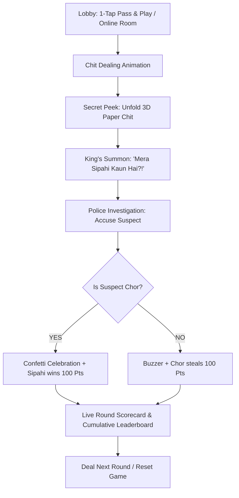

# 👑 ChitChor — The Modern Royal Paper Chit Game

> **Official Subdomain:** [chitchor.fixeehub.com](https://chitchor.fixeehub.com)  
> **Heritage:** A modern digital reinvention of the classic Indian parlour game *Raja Rani Chor Sipahi* (राजा रानी चोर सिपाही).  
> **Ecosystem:** Part of the FixeeHub Workspace network ([fixeehub.com](https://fixeehub.com)).

---

## 🌟 Overview

**ChitChor** brings the nostalgic paper-slip parlour game to mobile and desktop screens worldwide with **zero login**, **zero app downloads**, and instant **PWA installation**. Players secretly draw 3D folded paper chits, unfold them to inspect their assigned royal duty, and compete in court deduction.

---

## 🎨 Luxury Aesthetics & Design System

- **Background:** Luxury navy-slate (`#0b0f19`) with glassmorphic cards.
- **Primary CTA:** High-vibrancy Emerald Green gradient (`from-emerald-500 to-teal-600`) with dynamic glow.
- **3D Crisp White Paper Chits:** Realistic paper crease lines, folded texture, and an embossed golden wax seal (`राजा-रानी CHITCHOR`) with metallic ribbons.
- **Vibrant Role Colors:**
  - 👑 **Raja (King):** Golden Amber (`from-amber-400 to-yellow-500`)
  - 💎 **Rani (Queen):** Royal Rose Pink (`from-rose-500 to-pink-600`)
  - 🛡️ **Katual (Commander):** Purple Sapphire (`from-purple-500 to-indigo-600`)
  - ⚔️ **Sipahi (Police):** Bright Cyan/Blue (`from-cyan-500 to-blue-600`)
  - 🎭 **Chor (Thief):** Crimson Red (`from-red-600 to-rose-700`)

---

## ⚖️ Game Modes & Automated Scoring Engine

### Mode A: 4-Player Classic (Total 1,600 Pts)
| Role | Points | Rule |
| :--- | :--- | :--- |
| **Raja (King)** | `1,000 Pts` | Automatic royal tribute |
| **Rani (Queen)** | `500 Pts` | Sovereign tribute |
| **Sipahi (Police)** | `100 Pts` | Must guess who holds the Chor chit |
| **Chor (Thief)** | `0 Pts` | Starts with 0 baseline |

- **If Sipahi guesses CORRECT:** Sipahi receives **+100 Pts**, Chor receives **0 Pts**.
- **If Sipahi guesses WRONG:** Sipahi receives **0 Pts**, Chor steals **+100 Pts**.

### Mode B: 5-Player Extended (Total 2,300 Pts)
| Role | Points | Rule |
| :--- | :--- | :--- |
| **Raja (King)** | `1,000 Pts` | Supreme monarch |
| **Rani (Queen)** | `700 Pts` | Empress of grace |
| **Katual (Commander)** | `500 Pts` | Defender of the realm |
| **Sipahi (Police)** | `100 Pts` | Same guessing mechanics apply |
| **Chor (Thief)** | `0 Pts` | Steals 100 Pts on wrong accusation |

---

## 🕹️ Gameplay Flow



---

## 🛠️ Tech Stack & Architecture

- **Framework:** [Astro 5+ / 7+](https://astro.build) with SSR & Static Page Generation
- **UI & State:** [React 19](https://react.dev) with client-side interactive islands (`client:load`)
- **Styling:** [Tailwind CSS v4](https://tailwindcss.com) with `@tailwindcss/vite`
- **Networking:** [PeerJS](https://peerjs.com) for WebRTC serverless P2P multiplayer rooms
- **Audio Synthesizer:** Pure Web Audio API (zero external MP3 dependencies)
- **Visuals & Celebrations:** [canvas-confetti](https://www.npmjs.com/package/canvas-confetti) & [lucide-react](https://lucide.dev)
- **PWA:** Service worker (`sw.js`), Web App Manifest (`manifest.json`), offline caching

---

## 🔍 Google Search SEO & JSON-LD Structured Data

- **Primary Title:** `ChitChor — Play Raja Rani Chor Police Online (Free Paper Chit Game)`
- **Meta Keywords:** `ChitChor, Raja Rani Chor Police online game, Chor Sipahi paper game, 4 player paper chit game, Indian party board games online, Raja Mantri Chor Sipahi, Raja Wazir Chor Sipahi, pass and play parlour game`
- **Canonical URL:** `https://chitchor.fixeehub.com/`
- **Social Previews:** 1200×630 OpenGraph card (`og-image.svg`) with character crests
- **Structured Data:** Google `WebSite` & `VideoGame` schema (`@graph`) with `AggregateRating` and free pricing config
- **Crawler Directives:** `public/robots.txt` and `public/sitemap.xml`

---

## 🚀 Getting Started

### Prerequisites
- Node.js `v22.x` or later (tested on Node `v24.21.0`)
- npm `v10.x` or later

### Installation
```bash
# Clone the repository
git clone https://github.com/fixeehub/chitchor.git
cd chitchor

# Install dependencies
npm install
```

### Local Development
```bash
# Run local development server
npm run dev
```
Open [http://localhost:4321](http://localhost:4321) in your browser.

### Production Build
```bash
# Compile for production
npm run build
```
Builds static HTML & client bundles to `./dist/` with 0 compilation errors.

### Preview Production Build
```bash
npm run preview
```

---

## 📄 License & Credits

- **Product:** ChitChor
- **Network:** FixeeHub Workspace ([fixeehub.com](https://fixeehub.com))
- **Support:** [contact@fixeehub.com](mailto:contact@fixeehub.com)
- **Privacy:** [chitchor.fixeehub.com/privacy](https://chitchor.fixeehub.com/privacy)
